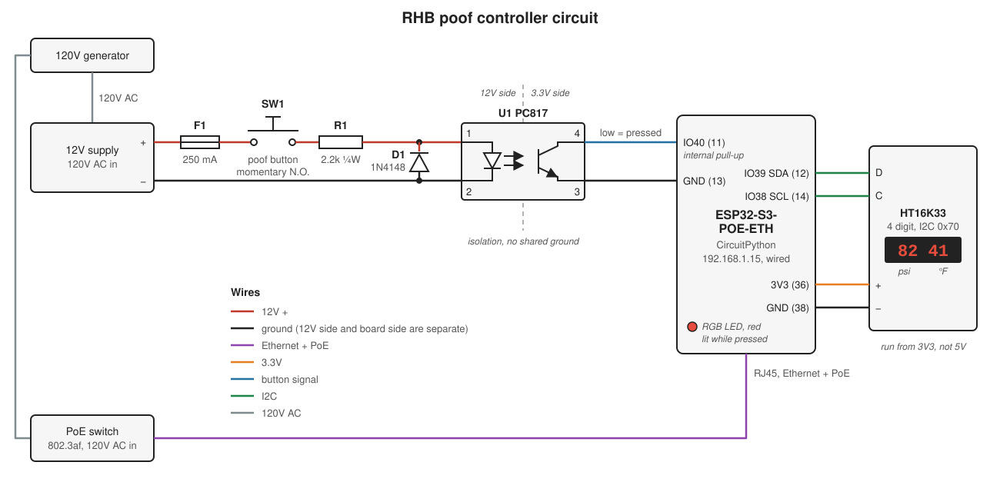

Poof Controller Hardware
========================

The poof button panel is a Waveshare ESP32-S3-POE-ETH, wired to the rig and
powered over PoE, with one optocoupler for the 12V button and a four digit
HT16K33 display.

[kicad/](kicad/README.md) has a two layer carrier board for it.

Board
-----

Use a **Waveshare ESP32-S3-POE-ETH**: the ESP32-S3-ETH with Waveshare's PoE
module.  It is the board rhb-water-heater runs on:

- One board type and one toolchain on the rig, and spares that swap.
- Its W5500 handling, which took some getting right, is already written and
  is reused here.
- Ethernet instead of WiFi, and one cable for network and power.

The PoE module needs an **802.3af** PoE switch or injector at the other end
of the cable.  A run can be up to 100 m.

The board is 72.8 x 21 mm.  Its 2 x 20 headers are Pico compatible: 2.54 mm
pitch, rows 17.78 mm apart, power and ground pins where a Pico's are.  Pin
numbers below are the physical pins, which Waveshare numbers like a Pico's,
1 and 40 at the RJ45 end.

Its two faces:

- **Top**: the RJ45 jack, its magnetics, the ESP32-S3, and the PoE module,
  which stacks on standoffs over the RJ45.
- **Bottom**: the W5500, the TF card slot and the USB-C port.

It mounts on the carrier top face up, on male headers soldered to point down
into female headers on the carrier, with the RJ45 end over the carrier's
edge.  The cable plugs into the end and the USB-C, needed to load code, stays
reachable.

System
------

    PoE switch (802.3af) ==== Cat5e/6, up to 100 m ==== RJ45
                                                         |
                                     PoE module -- 5V -- ESP32-S3-ETH
                                                         |  |  |
    120V generator                                       |  |  +-- I2C -- HT16K33 display
     |                                                   |  |
     +-- 12V supply -- fuse -- button -- opto LED        |  +-- opto transistor
                                           .  (isolated) .
                                           . . . . . . . .

    192.168.1.15, wired
      out: /poof         -> CLIENTS on :8888, body display on :10002
      in:  /pressure     <- rhb-sensor-monitor
           /temperature  <- rhb-water-heater
           /water_heater <- rhb-water-heater

The 12V side shares no ground with the board.  That is the point of the
optocoupler: the button's wiring runs out to the operator, and anything it
picks up stays on the 12V side.  Feeding the board from the 12V supply would
join the grounds and undo that.  With PoE nothing connects the board to the
12V supply's ground.

Wiring
------

### Power

| From | To |
| --- | --- |
| PoE switch or injector | RJ45, through the PoE module to VSYS |
| 12V supply + | Fuse, 250 mA, then the button |
| 12V supply - | PC817 pin 2 (cathode) |

USB-C also powers the board, for loading code on the bench.  The board's own
diode keeps PoE and USB from feeding each other.

### Button and optocoupler

    12V + --- fuse --- button --- 2.2k ---+--- PC817 1 (anode)
                       (N.O.)             |
                                       1N4148
                                     (cathode at pin 1)
                                          |
    12V - --------------------------------+--- PC817 2 (cathode)

    IO40 (pin 11) ----------------------------- PC817 4 (collector)
    GND  (pin 13) ----------------------------- PC817 3 (emitter)

| Part | Value | Why |
| --- | --- | --- |
| Button | momentary, normally open, rated for 12V | Closed while held |
| R1 | 2.2k, 1/4 W | (12V - 1.2V) / 2.2k = 4.9 mA through the LED, 5.4 mA at 13V.  The PC817 allows 50 mA |
| D1 | 1N4148 | Reverse across the LED.  The PC817 LED tolerates only 6V reversed, and a generator surge can ring the 12V line |
| U1 | PC817 | At 5 mA in and its worst case 50% CTR it sinks 2.5 mA; the pull-up needs well under 0.1 mA |
| Pull-up | ESP32 internal on IO40 | Enabled by `keypad`.  Add an external 10k to 3V3 (pin 36) only if the opto sits far from the board |

Pressed, the transistor pulls IO40 low; released, the pull-up holds it high.
`keypad` debounces 20 ms either way, so a spike shorter than that cannot
poof.

IO40 is free on this board.  Avoid IO35-37 (the PSRAM), IO0, IO3, IO45 and
IO46 (boot strapping), IO9-14 (the W5500), IO4-7 (the TF card), IO19-20 (USB)
and IO21 (the RGB LED).

### Display

An Adafruit 0.56" four digit seven segment backpack (HT16K33), address `0x70`
with no address jumpers bridged, on the same pins as rhb-water-heater's.

| Backpack | ESP32-S3-ETH |
| --- | --- |
| `+` (VCC) | 3V3, pin 36 |
| `-` (GND) | GND, pin 38 |
| `D` (SDA) | IO39, pin 12 |
| `C` (SCL) | IO38, pin 14 |
| `IO`, if present | 3V3, pin 36 |

Run it from 3V3, not 5V.  The backpack's pull-ups on `D` and `C` go to its
supply, and 5V on those lines would reach the ESP32's 3.3V-only pins.

### Onboard

The board's WS2812 RGB LED (IO21) lights red while the button is pressed.

Parts
-----

| Qty | Part |
| --- | --- |
| 1 | Waveshare ESP32-S3-POE-ETH (the ESP32-S3-ETH with the PoE module) |
| 1 | 2 x 20 male headers for it, and 2 x 20 female for the carrier |
| 1 | Adafruit 0.56" four digit seven segment display with I2C backpack |
| 1 | PC817 optocoupler |
| 1 | 2.2k resistor, 1/4 W |
| 1 | 1N4148 diode |
| 1 | Inline fuse holder and 250 mA fuse |
| 1 | Momentary N.O. pushbutton, 12V |
| 1 | 12V supply on the 120V system |
| 1 | 802.3af PoE switch or injector, and Cat5e or Cat6 cable |
