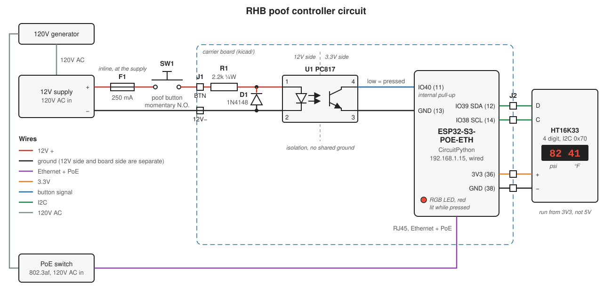

Poof Controller Hardware
========================

[kicad/](kicad/README.md) has the carrier board.

Board
-----

A **Waveshare ESP32-S3-POE-ETH**, the same board as rhb-water-heater, so
spares swap and its W5500 code is reused.  It needs an **802.3af** PoE switch
or injector; runs can be up to 100 m.

- 72.8 x 21 mm, Pico compatible 2 x 20 headers.  Pin numbers below are
  physical pins, 1 and 40 at the RJ45 end.
- **Top**: RJ45, ESP32-S3, PoE module stacked over the RJ45.
- **Bottom**: W5500, TF card slot, USB-C.
- Mounts top face up on the carrier, RJ45 end over the edge so the cable and
  USB-C stay reachable.

System
------

    PoE switch (802.3af) ==== Cat5e/6, up to 100 m ==== RJ45
                                                         |
                                     PoE module -- 5V -- ESP32-S3-ETH
                                                         |  |  |
    120V generator                                       |  |  +-- I2C -- HT16K33 display
     |                                                   |  |
     +-- 12V supply -- fuse -- button -- opto LED        |  +-- opto transistor
                                           .  (isolated) .
                                           . . . . . . . .

    192.168.1.15, wired
      out: /poof         -> CLIENTS on :8888, body display on :10002
      in:  /pressure     <- rhb-sensor-monitor
           /temperature  <- rhb-water-heater
           /water_heater <- rhb-water-heater

The 12V side shares no ground with the board, so noise picked up on the
button's long wire stays there.  Don't power the board from the 12V supply.

Wiring
------

### Power

| From | To |
| --- | --- |
| PoE switch or injector | RJ45, through the PoE module to VSYS |
| USB-C, on the bench | VSYS, diode isolated from PoE |
| 12V supply + | Inline 250 mA fuse, at the supply, then the button, then J1 `BTN` |
| 12V supply - | J1 `12V-` |

### Button and optocoupler

        off the carrier          |  on the carrier
                                 |
    12V + --- fuse --- button ---J1 BTN --- 2.2k ---+--- PC817 1 (anode)
                       (N.O.)    |                  |
                                 |               1N4148
                                 |             (cathode at pin 1)
                                 |                  |
    12V - -----------------------J1 12V- -----------+--- PC817 2 (cathode)

    IO40 (pin 11) ----------------------------- PC817 4 (collector)
    GND  (pin 13) ----------------------------- PC817 3 (emitter)

The fuse sits at the supply so it protects the whole wire run to the button.

| Part | Value | Why |
| --- | --- | --- |
| Button | momentary, N.O., 12V | |
| R1 | 2.2k, 1/4 W | 4.9 mA through the LED at 12V; the PC817 allows 50 mA |
| D1 | 1N4148 | The PC817 LED takes only 6V reversed; generator surges can ring the 12V line |
| U1 | PC817 | 2.5 mA out at worst case 50% CTR, plenty for the pull-up |
| Pull-up | ESP32 internal on IO40 | Add 10k to 3V3 (pin 36) only if the opto is far from the board |

Avoid IO35-37 (PSRAM), IO0, IO3, IO45, IO46 (strapping), IO9-14 (W5500),
IO4-7 (TF card), IO19-20 (USB) and IO21 (RGB LED).

### Display

Adafruit 0.56" four digit backpack (HT16K33), address `0x70`.

| Backpack | ESP32-S3-ETH |
| --- | --- |
| `+` (VCC) | 3V3, pin 36 |
| `-` (GND) | GND, pin 38 |
| `D` (SDA) | IO39, pin 12 |
| `C` (SCL) | IO38, pin 14 |
| `IO`, if present | 3V3, pin 36 |

Use 3V3, not 5V: the backpack pulls `D` and `C` up to its supply.

Parts
-----

| Qty | Part |
| --- | --- |
| 1 | Waveshare ESP32-S3-POE-ETH |
| 1 | 2 x 20 male headers, and 2 x 20 female for the carrier |
| 1 | Adafruit 0.56" four digit seven segment display with I2C backpack |
| 1 | PC817 optocoupler |
| 1 | 2.2k resistor, 1/4 W |
| 1 | 1N4148 diode |
| 1 | Inline fuse holder and 250 mA fuse |
| 1 | Momentary N.O. pushbutton, 12V |
| 1 | 12V supply on the 120V system |
| 1 | 802.3af PoE switch or injector, and Cat5e or Cat6 cable |
