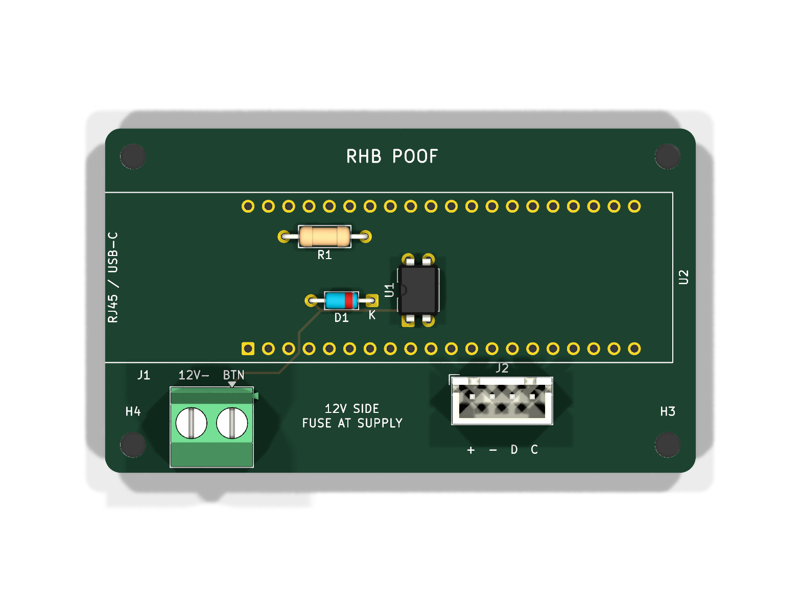

Poof Controller Board
=====================

Two layer, 74 x 43 mm carrier for the circuit in [HARDWARE.md](../HARDWARE.md).
Parts: [bom.csv](bom.csv).

- **U2** mounts top face up; its RJ45 / USB-C end overhangs the left edge by
  2 mm.
- **R1, D1 and U1** sit under U2, between its header rows.  Fit them
  before the sockets, and keep them under 4.5 mm tall.
- **J1** takes the button wire, after the inline fuse at the supply, and the
  supply's negative.
- The bottom ground pour leaves out the 12V side, J1, R1, D1 and the
  PC817's LED pins, except for a strip along U2's pin 1-20 row.

The U2 footprint comes from Waveshare's dimension drawing.  **Check it against
a real board before ordering**: lay the module on a 1:1 print and see that
pin 1 lands on the square pad.  Also check that R1, D1 and U1 clear the
W5500, TF slot and USB-C on the module's underside once it's in its sockets.

Regenerating
------------

Edit the scripts, not the KiCad files, then run `./build.sh`.  Routing needs
Java 17+ and `~/tools/freerouting-1.9.jar`.

Expected warnings:

| Warning | Why |
| --- | --- |
| `lib_symbol_issues` | Symbols live only in the schematic |
| `extra_footprint` | Mounting holes aren't in the schematic |
| `silk_edge_clearance` | U2's outline runs past the board edge |
